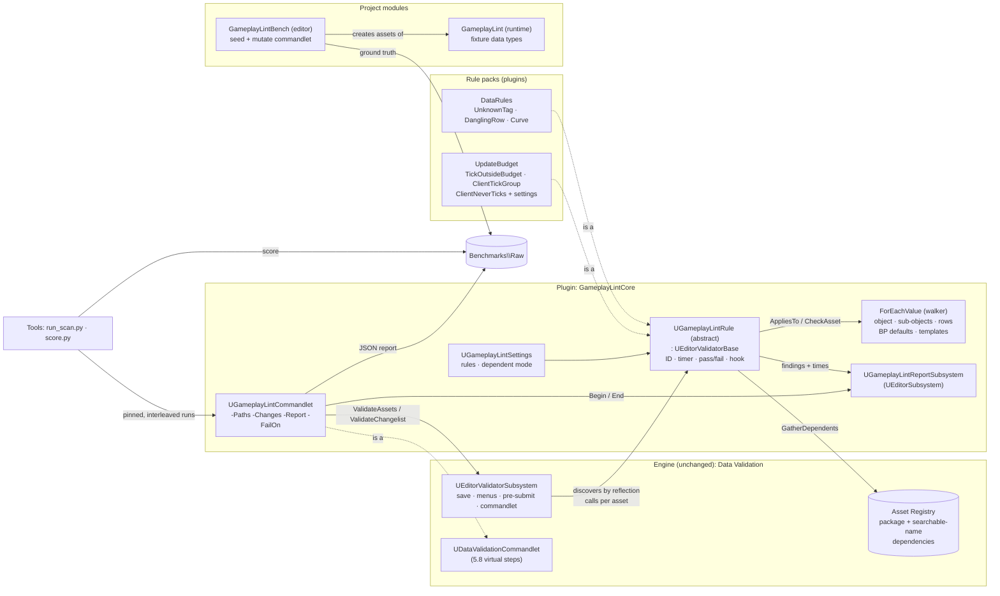
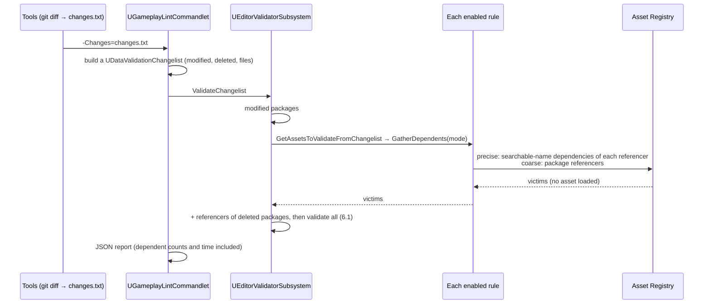

# 02 · System Architecture: GameplayLint (v1.0, final)

**Phase:** 3 (Architecture), **final**, 2026-11-21. It replaces the one-line plan in the roadmap; the changes are listed in §14.
**Engine:** UE 5.8.4. Every engine behaviour relied on here is verified in [01b_Research_Findings.md](01b_Research_Findings.md); references like `01b #3` point to its §1 table.
**Rule:** this is the design *before* rule code (Phase 3). If implementation proves a decision wrong, this file is updated in the same step.

---

## 1. Goals and non-goals

**Goals**
1. Find broken **relations** in gameplay data: unknown tags, dangling DataTable and CurveTable rows, curves that break their declared contract, and the data-level mistakes documented by UE5-UpdateBudget.
2. Run **everywhere Data Validation runs**: on save, from the editor's menus, before submit, in CI. One set of rules, no parallel tool.
3. When a referenced thing changes (a row removed, a tag file edited, a parent Blueprint changed), **re-validate its unchanged victims** in incremental runs.
4. Give every finding a stable **rule ID**, the asset, a **property path** and the lesson it encodes, so CI can gate and trend on it.
5. **Measure** the tool: detection rate and false positives on a seeded corpus, full and incremental scan cost (`01` §7).
6. Let later projects add rule packs **without changing the core** (`01` E1).

**Non-goals (v1)**
- A validation framework (the engine has one, `01b` §2).
- Code analysis. C++ mistakes belong to code review and to UE5-TestTrust's mutation testing.
- Naming and style rules (Linter v2 and others cover them).
- Automatic repair of meaning-level problems: a dangling row needs a human decision.
- A "no load" scan mode (deferred to Phase 8, only if the data justify it, `01b` #6).
- The cook-reachability rule from UE5-UpdateBudget's mistakes (deferred, `12`).

## 2. The core idea in plain words

The engine already runs validators everywhere. A validator is a class; the engine finds every concrete subclass by reflection and calls it for each asset (`01b` #1). So:

1. **Each rule is a validator class.** A small abstract base class, `UGameplayLintRule`, gives every rule a stable ID, a lesson, a severity, a timer, a report and the engine's pass/fail contract. A rule only answers two questions: *does this rule apply to this asset?* (from registry data, without loading) and *what is wrong with it?* (on the loaded asset).
2. **Rules don't walk data themselves.** A shared walker visits everything an asset holds (the object, its instanced sub-objects, DataTable rows, Blueprint class defaults and component templates) and hands a rule every value of one struct type, with a readable path such as `Payloads[3].Loot`.
3. **Rules know their victims.** When an incremental run sees a change, each rule says which *other* assets that change can break. It asks the asset registry, which already records tag and row references as searchable names (`01b` #5). No asset is loaded to find them. The engine then validates them as usual, through its own hook (`01b` #3).
4. **A child commandlet makes CI useful.** It adds a path filter, a changelist read from a file (for example from `git diff`), a JSON report and an exit code that means "these assets have findings".

```text
                    ┌───────────── engine: Data Validation (unchanged) ─────────────┐
 save/menu/submit/CI│  load asset → IsDataValid → every enabled validator → messages │
                    └───────────────────────────────┬───────────────────────────────┘
                                                    │ GameplayLint rules ARE validators
            ┌───────────────────────────────────────┴───────────────────────────┐
            │ UGameplayLintRule (core): ID · timer · report · pass/fail · hook  │
            │      ▲ rule packs: DataRules, UpdateBudget, (later: one per project)
            │ walker (core): every value of type T inside an asset, with a path │
            └────────────────────────────────────────────────────────────────────┘
```

**Rejected alternatives for the core shape:**

| Alternative | Why we rejected it |
|---|---|
| A separate framework with its own commandlet, like Linter v2 | Duplicates Data Validation and loses on-save, menu and pre-submit coverage. Teams would run two tools |
| One "GameplayLint" validator that dispatches to rule objects | Needs its own registration, and loses what the engine gives per validator class for free: discovery, `bIsConfigDisabled`, per-class timing (`01b` B-1) |
| Rules as `IsDataValid` overrides in game classes | Works only for classes the project owns; can't check a tag inside an engine or third-party struct; and it puts tooling into runtime code |
| Python validators | Possible (the engine supports them), but needs the Python plugin, is slower per asset, and reflection walking is natural in C++ |

## 3. Modules and where they live

```text
D:\UNREAL PORTFOLIO\P10_GameplayLint\GameplayLint\                 ← the UE project
├── GameplayLint.uproject
├── Source\GameplayLint\                    ← game module (Runtime): the data types the test corpus is made of
├── Source\GameplayLintBench\               ← editor module: the corpus seeding and mutation commandlet
├── Plugins\GameplayLintCore\               ← the reusable framework (Editor); contains no rules
├── Plugins\GameplayLintDataRules\          ← rule pack: tags, row handles, curves (Editor)
├── Plugins\GameplayLintUpdateBudget\       ← rule pack: UE5-UpdateBudget's data-level mistakes (Editor)
└── Config\  Content\  (Content\GLSeed\ is generated, never committed)
D:\UNREAL PORTFOLIO\P10_GameplayLint\Tools\  ← scan runner, scoring, CPU mask, build scripts (not part of the UE project)
```

| Module | Type | Responsibility | Depends on |
|---|---|---|---|
| `GameplayLintCore` (plugin) | Editor | Rule base class, finding and report types, data walker, settings, report subsystem, child commandlet | Public: `Core`, `CoreUObject`, `Engine`, `DataValidation`, `DeveloperSettings`, `EditorSubsystem` (the public headers derive from their classes). Private: `Json`, `SourceControl` (`DataValidationChangelist.h` includes its headers), `UnrealEd` (`GEditor`); `AssetRegistry` when first used |
| `GameplayLintDataRules` (plugin) | Editor | `GL.Data.UnknownTag`, `GL.Data.DanglingRow`, `GL.Data.Curve` | `GameplayLintCore`, `DataValidation` (see the link rule below), `GameplayTags`, `AssetRegistry` |
| `GameplayLintUpdateBudget` (plugin) | Editor | `GL.UB.TickOutsideBudget`, `GL.UB.ClientTickGroup`, `GL.UB.ClientNeverTicks`, and the pack's settings | `GameplayLintCore`, `DataValidation`, `DeveloperSettings`, `AssetRegistry` |
| `GameplayLint` (project, primary) | Runtime | Fixture gameplay types: a data asset, a DataTable row struct, payload structs, an instanced object, an agent actor, a stand-in budget client component, a plain ticking component | `Core`, `CoreUObject`, `Engine`, `GameplayTags` (public: the fixture headers are public) |
| `GameplayLintBench` (project) | Editor | `UGameplayLintSeedCommandlet`: builds the corpus and its ground truth from a seed; applies mutations M1–M4. The automation tests of the core (`Private/Tests`) | `GameplayLint`, `GameplayLintCore`, `DataValidation`, `UnrealEd`, `AssetRegistry`, `GameplayTags`, `Json` |
| `Tools\` | Python, batch | `run_scan.py` (interleaved, pinned runs and the batch manifest), `score.py` (recall and false positives vs ground truth), `core_mask.py`, `build.bat`, `package.bat`, `smoke_game.bat`, `validate.bat` | — |

**The link rule (found in S1–S4):** every module that defines a rule, or calls a validator's functions, must list `DataValidation` itself. The core's public dependency gives such a module the include paths but not the import library: the first S1–S4 build compiled, then the bench module failed to link `UEditorValidatorBase::K2_ValidateLoadedAsset_Implementation` and three more symbols (`09`, S1–S4). Because `DataValidation` is a plugin module, each rule pack's `.uplugin` must also list the `DataValidation` plugin (`06` §5).

**The dependency rules:**
- packs → core → engine, never the reverse;
- the core knows no rule;
- **no lint module is a dependency of the game module**: the game does not know the rules exist;
- the bench module may know the game module's fixture types; the rules never see the bench module or its ground truth.

**Naming:** plugin names equal their module names, like UE5-UpdateBudget's `UpdateBudgetCore`. Every rule pack is a plugin, so a project enables, disables or copies a pack as one folder. Public headers use the 5.8 export pattern (`#define UE_API GAMEPLAYLINTCORE_API` … `#undef UE_API`). **Packs have no public headers at all**: the engine finds their classes by reflection, so nothing needs to include them.

**Why the UpdateBudget pack doesn't link against UpdateBudgetCore:** the portfolio rule is that projects never reference each other's folders. The pack names its classes by `FSoftClassPath` in its settings (default `/Script/UpdateBudgetCore.BudgetedUpdateComponent`). In UE5-UpdateBudget the default resolves; here the project config points it at a fixture class that mirrors the real component's tick defaults.

## 4. Classes

### 4.1 Plugin `GameplayLintCore` (7 pieces, each with a reason)

| Class | Kind / base | Responsibility | Why it exists, and what we rejected |
|---|---|---|---|
| `UGameplayLintRule` | `UCLASS(Abstract)` deriving `UEditorValidatorBase` | The rule contract. Holds `RuleId`, `Lesson`, `DefaultSeverity`. Implements the engine overrides **once**: `IsEnabled` (settings and command line), `CanValidateAsset_Implementation` (calls `AppliesTo`), `ValidateLoadedAsset_Implementation` (times `CheckAsset`, turns findings into messages and report entries, then calls `AssetPasses` or fails), `GetAssetsToValidateFromChangelist` (calls `GatherDependents`). Rule authors override only `AppliesTo`, `CheckAsset` and optionally `GatherDependents` | The engine skips abstract classes (`01b` #1), so the base is never instantiated. It owns the pass/fail contract that otherwise fires `ensure`s (`01b` #9). *Rejected:* letting each rule implement the engine overrides itself (40 lines of repeated, error-prone glue per rule) |
| `FGameplayLintFinding` | `USTRUCT` | One finding: rule ID, asset path (`FSoftObjectPath`), severity, property path, message | Stored by path, not by pointer, so a report outlives unloaded assets |
| `FGameplayLintContext` | Plain C++ class | Passed to `CheckAsset`. `Report(Severity, Where, Message)`; access to the asset data | Collects findings for one asset, so the base class can decide pass/fail afterwards. *Rejected:* calling `AssetFails` directly from rules (no structured record, no path) |
| `GameplayLint::ForEachValue` (the walker) | Free functions in a namespace | Visits an asset's object, its instanced sub-objects, DataTable rows, and a Blueprint's class default and component templates (`01b` #10–11). For each value of a requested `UScriptStruct`, calls back with the memory, the owning property (for metadata) and a readable path | One correct traversal shared by every rule; testable without the engine's validation loop. *Rejected:* a walker class with state (nothing to keep between calls) |
| `UGameplayLintSettings` | `UDeveloperSettings` (`config=Editor, defaultconfig`) | Master switch, disabled rule IDs, dependent mode (`Off`, `Coarse`, `Precise`). Command-line overrides for benchmark configurations: `-GameplayLintRules=`, `-GameplayLintDependents=` | One place for "which rules run". Command-line switches give F0–F3 and I0–I3 from one binary (§9) |
| `UGameplayLintReportSubsystem` | `UEditorSubsystem` | Collects findings and per-asset rule times while a report is open (`Begin` / `End`). Outside a report (normal editing), rules only produce Message Log entries | Rules are created by the engine, not by us, so they need a well-known place to report to. An editor subsystem has the right lifetime (the editor session) and is found with `GEditor->GetEditorSubsystem<>()`. *Rejected:* a global variable (no clear owner); parsing rule IDs back out of message text (fragile) |
| `UGameplayLintCommandlet` | `UDataValidationCommandlet` (`-run=GameplayLint`) | Overrides the 5.8 steps (`01b` #7): `ProcessCommandLine` (`-Paths=`, `-Changes=<file>`, `-Report=<file>`, `-FailOn=`), `FilterAssetsToValidate` (paths), `ValidateAssets` (opens the report; per-asset details on; full scan **or** a pseudo-changelist through the engine's `ValidateChangelist`), `ProcessValidationResults` (writes JSON: findings, per-asset errors and warnings, per-validator totals, phase timings). Exit codes: 0 clean, 2 could not run (engine's meaning), 3 findings at or above `-FailOn` | Reuses the engine's validation path, so F0 and F1 differ only in which rules are enabled. *Rejected:* parsing the stock commandlet's log (no rule IDs, and the exit code reflects any logged error, `01b` B-2) |

**Rule author's view (the whole API):**

```cpp
UCLASS()
class UGLRule_Example : public UGameplayLintRule
{
	GENERATED_BODY()
public:
	UGLRule_Example();                                                    // sets RuleId, Lesson, DefaultSeverity
protected:
	virtual bool AppliesTo(const FAssetData& AssetData) const override;   // registry data only: no load
	virtual void CheckAsset(UObject* Asset, FGameplayLintContext& Lint) override;
	virtual void GatherDependents(const UDataValidationChangelist& Change, EGameplayLintDependents Mode,
	                              TArray<FAssetData>& OutAssets) const override;   // optional
};
```

### 4.2 Plugin `GameplayLintDataRules` (3 rules)

| Rule ID | Class | Applies to | Finds | Dependents (precise / coarse) |
|---|---|---|---|---|
| `GL.Data.UnknownTag` | `UGLRule_UnknownTag` | any asset | An `FGameplayTag`, or a tag in an `FGameplayTagContainer`, whose name is not in the dictionary (`RequestGameplayTag(Name, false)` fails, `01b` §3) | If a tag config file changed: every package whose searchable-name dependencies hold an `FGameplayTag` value that is no longer in the dictionary / every package with any tag reference |
| `GL.Data.DanglingRow` | `UGLRule_DanglingRow` | any asset | `FDataTableRowHandle` and `FCurveTableRowHandle`: table set but row missing; row set but table null; row None where the property has `meta=(LintRequired)` | For each changed or deleted table: its package referencers whose searchable-name rows are no longer in the table / every package referencer of the table |
| `GL.Data.Curve` | `UGLRule_Curve` | any asset | Non-finite curve data (key time or value, tangents, the default value an empty curve returns) in an `FRuntimeFloatCurve` property, a `UCurveFloat` asset or a `UCurveTable` row, always; a reversal where the property says `LintMonotonic="Increasing"` or `"Decreasing"` (an unknown value is reported, never guessed); no data at all (no key, no default value) where it says `LintRequired`. An external curve's keys are reported once, on the curve asset; the property's contracts are checked on its owner, naming the external asset (S6 code review) |

Annotations are UPROPERTY metadata, read in editor builds only (`01b` §3). A programmer writes the meaning where the data is declared:

```cpp
UPROPERTY(EditAnywhere, meta = (LintMonotonic = "Increasing"))
FRuntimeFloatCurve CooldownByLevel;   // a cooldown must never get shorter as the level rises
```

### 4.3 Plugin `GameplayLintUpdateBudget` (3 rules + settings)

`UGameplayLintUpdateBudgetSettings` (`UDeveloperSettings`, `config=Editor, defaultconfig`):

| Setting | Default | Meaning |
|---|---|---|
| `BudgetClientClasses` | `/Script/UpdateBudgetCore.BudgetedUpdateComponent` | Component classes that run through the update budget |
| `SchedulerTickGroup` | `TG_PrePhysics` | The scheduler's tick group in UE5-UpdateBudget |
| `BudgetScopeActorClasses` | empty | Actor classes whose per-frame work must go through the budget. An actor that contains a budget client is always in scope |
| `PerFrameAllowList` | `SkeletalMeshComponent`, `MovementComponent` | Components allowed to tick every frame in scope: animation has Epic's own budget allocator, and movement integrates every frame (UE5-UpdateBudget `01` §8) |

| Rule ID | Class | Applies to | Finds | Lesson |
|---|---|---|---|---|
| `GL.UB.TickOutsideBudget` | `UGLRule_TickOutsideBudget` | actor Blueprints (registry parent-class tags) | An in-scope actor whose own tick, or a component that is not a budget client and not allow-listed, ticks **every frame**: `bCanEverTick && bStartWithTickEnabled && TickInterval <= 0`, exactly what the tick manager registers and enables at spawn (`01b` §3) | UE5-UpdateBudget `02` §11 and `01` §1 |
| `GL.UB.ClientTickGroup` | `UGLRule_ClientTickGroup` | actor and component Blueprints | A budget client template (or a Blueprint subclass of a client) whose `TickGroup` differs from `SchedulerTickGroup`. Offers a fixer that sets the group (optional, last step) | UE5-UpdateBudget `07`: "Leaving the default `TG_DuringPhysics`" |
| `GL.UB.ClientNeverTicks` | `UGLRule_ClientNeverTicks` | actor and component Blueprints | A budget client template whose tick can never start (`!bCanEverTick` or `!bStartWithTickEnabled`) | UE5-UpdateBudget `07`: "Forgetting `bCanEverTick = true`" |

Dependents (all three): when an actor Blueprint changes, the Blueprints that derive from it (`IAssetRegistry::GetDerivedClassNames`), because they inherit its components; when the pack's settings file changes, every asset the rule applies to.

### 4.4 Game module `GameplayLint` (fixture types, runtime)

| Type | Base | Why |
|---|---|---|
| `UGLFixtureDataAsset` | `UPrimaryDataAsset` | Holds every structural variant: top-level tag, container, row handles (one `LintRequired`), curves (`LintMonotonic` "Increasing" and, since S6, "Decreasing"; one `LintRequired`), a nested payload, `TArray` and `TMap` of payloads, an instanced object, an `FInstancedStruct` payload, and a project-style two-field reference (`LootTable` + `LootRow`, the held-out kind) |
| `FGLFixturePayload` | `USTRUCT` | A tag, a row handle and a curve, reused at every nesting level |
| `FGLFixtureRow` | `FTableRowBase` | DataTable rows that themselves hold tags, handles and curves |
| `UGLFixtureInstanced` | `UObject` (`EditInlineNew, DefaultToInstanced`) | The instanced sub-object variant |
| `AGLFixtureAgent`, `AGLFixtureTickingAgent` | `AActor` | The budget scope's base class; the second ticks natively, the "inherited actor tick" defect |
| `UGLFixtureBudgetClient` | `UActorComponent` | Stand-in for UE5-UpdateBudget's `UBudgetedUpdateComponent`, with the same tick defaults (`bCanEverTick = true`, `TG_PrePhysics`) |
| `UGLFixtureTicker` | `UActorComponent` | A plain per-frame ticking component |

They are runtime types because in a real project they *are* game data; the packaged build compiles them, which keeps the isolation check honest.

### 4.5 Editor module `GameplayLintBench`

`UGameplayLintSeedCommandlet` (`-run=GameplayLintSeed`):
- `-Seed=<n> -Assets=<N> -Out=/Game/GLSeed -Manifest=<file>`: creates the corpus (`01` §7.1) with a seeded `FRandomStream` and writes the ground truth.
- `-Mutate=M1|M2|M3|M4 -Changes=<file> -Expect=<file>`: applies one mutation, writes the changed packages and files (the pseudo-changelist) and the defects that the mutation creates.

It saves packages with the engine's save API and builds Blueprints with `FKismetEditorUtilities` (`01b` §3). Because it is a commandlet, the corpus is reproducible and is created through the UE job queue, never by hand.

## 5. Overview diagram



## 6. Flows

There is no per-frame flow: this is editor tooling. The two flows that matter are **one asset** and **one incremental run**.

### 6.1 One asset (identical on save, menu, pre-submit and CI)

```mermaid
sequenceDiagram
  participant S as UEditorValidatorSubsystem
  participant R as UGameplayLintRule (base)
  participant D as Concrete rule
  participant W as Walker
  participant P as Report subsystem
  S->>S: load the asset if needed (load warnings captured)
  S->>S: IsDataValid; if Invalid, stop here (01b #2)
  S->>R: CanValidateAsset(AssetData)
  R->>D: AppliesTo(AssetData)   (registry tags only)
  S->>R: ValidateLoadedAsset(Asset)
  R->>D: CheckAsset(Asset, Context)   (timed)
  D->>W: ForEachValue(Asset, FDataTableRowHandle)
  W-->>D: value, owning property, "Payloads[3].Loot"
  D->>R: Context.Report(Error, path, message)
  R->>P: record findings + time (if a report is open)
  R-->>S: Invalid + "[GL.Data.DanglingRow] Payloads[3].Loot: row 'Sword_02' not in DT_Loot"
```

### 6.2 One incremental run



### 6.3 Dependent gathering, in code-sized pseudocode (the real code mirrors this)

```text
DanglingRow, precise:
  for each changed DataTable T in the change:            // modified or deleted
      Rows = T's row names now (empty if deleted)          // one load per table; tables are few
      for each package P referencing T's package:          // registry, no load
          for each searchable-name dependency (T, Row) of P:
              if Row not in Rows: victims += P's assets; break
UnknownTag, precise (only if a tags .ini changed):
  for each package P in scope:                             // registry only
      for each searchable-name dependency (FGameplayTag, Name) of P:
          if not RequestGameplayTag(Name, false): victims += P's assets; break
```

## 7. Defaults and why

| Setting | Default | Reasoning |
|---|---|---|
| `GL.Data.UnknownTag` severity | Error | Tag queries silently return false at run time (`01` §6) |
| `GL.Data.DanglingRow` severity | Error | `GetRow` returns null at run time |
| `GL.Data.Curve` severity | Error | NaN propagates; an annotation is an explicit contract written by the programmer |
| `GL.UB.TickOutsideBudget` severity | Warning | A performance contract, not a crash; a team may accept a known exception |
| `GL.UB.ClientTickGroup` severity | Warning | Frame-order fairness, not function |
| `GL.UB.ClientNeverTicks` severity | Error | The native path can never run: a functional bug |
| "Ticks every frame" | `bCanEverTick && bStartWithTickEnabled && TickInterval <= 0` | Exactly what the tick manager registers and enables at spawn (`01b` §3). Interval ticks are a deliberate choice, not a mistake |
| Budget scope | actors containing a budget client, plus listed base classes | Conservative: false positives switch tools off (`01` §6) |
| Dependent mode | `Precise` | The design; `Off` and `Coarse` exist for measurement (I1, I2) |
| Commandlet scope | `/Game` (engine content filtered, as stock) | Matches the stock commandlet (`01b` §2) |
| `-FailOn` | `Error` | Warnings inform, errors gate. A team can tighten it |
| Messages | `[RuleId] path: message` plus an asset token | Clickable in the Message Log, searchable in CI logs |

## 8. Lifetime and safety rules

| Risk | Rule | Evidence |
|---|---|---|
| The engine keeps **one rule instance per class** for the whole session and resets its state per asset | Rules hold no per-asset or per-run state in members. Per-run state lives in the report subsystem, opened and closed by its owner | `01b` §2; `EditorValidatorBase.cpp:20` (`ResetValidationState`) |
| Returning `NotValidated` after `CanValidateAsset` said yes fires an `ensure` | The base class always ends with `AssetPasses` or an error. Concrete rules can't return a result | `01b` #9 |
| Checks run on save and before submit: modifying data there dirties packages | `CheckAsset` receives the asset but **never modifies it**. Only an explicit, user-clicked fixer may change data | `01b` #8 |
| A class-level `IsDataValid` error hides rule findings | Documented. The corpus measures it; a rule can't work around the engine's order | `01b` #2 |
| Reports must outlive unloaded assets | Findings store `FSoftObjectPath`, never `UObject*` | §4.1 |
| Dependent gathering sees only saved data | Correct for pre-submit and CI, which validate saved files. Documented for editor use | `01` §9 |
| Unattended changelist validation with a scanning registry is fatal | The commandlet waits for the registry first (the base class does this) | `01b` §2 |
| A rule's settings point at a class that isn't loaded (another project's component) | Settings use `FSoftClassPath`, resolved without forcing a load; an unresolved class means "no budget clients here" and the rule applies to nothing | §4.3 |
| Walking Blueprint data in the wrong place | Use the compiled class default and `ForEachComponentOfActorClassDefault`, which applies child-Blueprint overrides, instead of reading SCS nodes directly | `01b` #10 |
| Everything runs on the game thread | No async work in v1. Asset loading and validation are already serial in the engine's loop | `01b` §2 |

## 9. One binary for every configuration

All eight configurations of `01` §7.2 run the same build with different switches. Only the rule set and the dependent mode change; asset loading, engine validators and the report path are identical.

| Config | Command line (after `-run=GameplayLint -Report=…`) |
|---|---|
| F0 | `-GameplayLintRules=None` |
| F1 | `-GameplayLintRules=All` |
| F2 | `-GameplayLintRules=GL.Data` |
| F3 | `-GameplayLintRules=GL.UB` |
| I0 | `-Changes=<file> -GameplayLintRules=None` |
| I1 | `-Changes=<file> -GameplayLintRules=All -GameplayLintDependents=Off` |
| I2 | `-Changes=<file> -GameplayLintRules=All -GameplayLintDependents=Coarse` |
| I3 | `-Changes=<file> -GameplayLintRules=All -GameplayLintDependents=Precise` |

F0's equivalence with the stock `-run=DataValidation` (same "Files Checked / Failed" counts on the same corpus) is checked once and recorded in `09`.

## 10. C++ vs Blueprint

| C++ | Blueprint / editor UI |
|---|---|
| Every rule, the walker, dependent gathering, the commandlet, the seeding commandlet: they work on reflection data and the registry, which is natural and fast in C++ | Project Settings pages for the core and each pack (rule switches, budget classes, allow-list); clickable Message Log findings; the optional fixer button. A team can still write its own Blueprint validators on the engine's base class, outside GameplayLint |

## 11. How it grows into a production game (not built now)

- **One pack per portfolio project**, each written from that project's documented mistakes once it exists. Candidates, to be confirmed by those projects: UE5-SpawnPacer (a pooled actor class without its reset contract), UE5-AnimEventClock (gameplay-critical montage notifies not baked into its event track), UE5-SquadQuery (Smart Object slots without matching animations, the roadmap's example), UE5-NavReadyPCG (generated content that affects navigation without the "AI-ready" step), UE5-StateHandoff (Mass state with no declared owner).
- **Suppressions:** a per-asset "known issue" list with a reason and an expiry, so a team can adopt the tool on an existing project without drowning in old findings.
- **Trend reports** in CI: findings per rule over time, from the JSON reports (Respawn's "measure the impact").
- **Editor menu integration:** point `DataValidationCommandletClassName` at the child commandlet so Tools → Validate Data writes a report too.
- **A registry-only fast mode** (no loads) for very large projects, if Phase 8 shows load time hides rule value.
- **The cook-reachability rule** from UE5-UpdateBudget (`12`), validated against a packaged build's cooked file list.

## 12. Known limits (stated, not hidden)

1. **Detection on a self-made corpus is an upper bound.** Mitigated by fixing kinds, variants, near-misses and held-out kinds before rule code (`01` §7.1, §9).
2. **Not recognised or not walked in v1:** level-placed data (a map is one `UWorld` asset; the walker does not visit its actors or external actors, found by the S5 code review), a project's own reference types (a table and a row name in two plain fields: the corpus's held-out kind), Blueprint graph pin literals, values hidden in custom serialisation. These are expected misses. (`FInstancedStruct` payloads *are* walked: 5.8's property iterator unwraps them, `UnrealType.cpp:57–65`.)
3. **Registry data is on-disk only.** Unsaved edits don't feed dependent gathering.
4. **Load time dominates.** GameplayLint can't make the engine's full scan faster than its loads (`01b` #6).
5. **The UpdateBudget rules depend on configuration.** Wrong class paths give wrong results; the settings page says so.
6. **Masking by class-level validation** is the engine's order and stays (`01b` #2).
7. **One machine, synthetic content.** The real-content false-positive rate is unknown until the packs run on other projects' content.

## 13. Rejected alternatives (summary)

| Alternative | Why not |
|---|---|
| Own framework and runner (Linter-style) | Duplicates Data Validation; loses on-save and pre-submit (§2) |
| One dispatcher validator | Loses engine discovery, per-class timing and config disabling (§2) |
| `IsDataValid` in game classes | Project classes only; tooling in runtime code (§2) |
| Re-validate everything on any change | Correct but defeats incremental validation; measured as the coarse mode instead |
| Load referencers to find victims | Slow and unnecessary: the registry already records the references (`01b` #5) |
| Auto-fix dangling rows and unknown tags | Any guess can be wrong; a human decides (`01b` #8) |
| A cache of DataTable row names in the subsystem | The handle's table is a hard reference, so it is already loaded when the referencer is; only dependent gathering loads tables, once per changed table |
| Linking the UpdateBudget pack against UpdateBudgetCore | Breaks the portfolio's standalone-repo rule; soft class paths work in both projects (§3) |

## 14. Changes from the roadmap plan (2026-11-19 → 2026-11-21)

| Change | Why |
|---|---|
| "Cross-asset validators plus a CI commandlet" became **rule packs on Data Validation + a child commandlet** | The framework, the incremental hook and fixers already exist (`01b` #1, #3, #8) |
| The tag rule's claimed value narrowed to attribution, on-save and incremental coverage | The engine already warns about unknown tags on fresh loads (`01b` #4) |
| Dependent gathering through registry searchable names became the central feature | The registry records tag and row references at save (`01b` #5) |
| Measured configurations F0–F3 and I0–I3 instead of "detection rate on seeded defects" alone | A detection rate needs a baseline (the stock run) and the incremental question needs its own ablation |
| The cook-reachability lesson deferred | Its ground truth is a packaged build, not a per-asset corpus |
| "Smart Object slots without matching animations" moved to the AI project's pack | It is that project's data and lesson |
